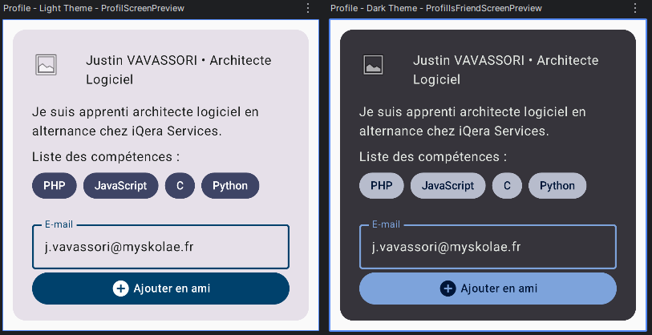

# Profil développeur Compose
TP jetpack compose de création d'un profil développeur, avec nom, prénom, le poste occupé, 
les compétences techniques, ainsi qu'une rapide description de la personne, la possiblité d'ajouter 
en ami (non fonctionnel).  
De plus, un système de thème sombre et clair.

## Composant utilisés
- Composables
- Previews
- Modifiers
- Text
- Buttons
- Column
- Padding
- Card
- Spacer
- OutlinedTextField
- LazyRow
- Surface
- Box

## Layout utilisés
- Arrangement
- Box
- Column
- Row
- Spacer
- fillMaxSize
- fillMaxWidth
- height
- padding

## Explication courte `LazyRow`
La liste `LazyRow` est une liste horizontale avec les langages connu de la personne.   
Cette liste se charge petit à petit en fonction de la "demande".

## Explication des thèmes
*Je suis pas sûr d'avoir bien compris la question...*
Pour les thèmes, j'ai opté avec `ProfilShapes` dans `Theme.kt` pour des `RoundedCornerShape` afin de
rendre le visuel plus lisse.  
De même au niveau des couleurs avec `LightColorScheme` et `DarkColorScheme` en mettant des couleurs 
pas trop forte pour alléger visuellement.

## « Quelles notions du chapitre Compose UI avez-vous réutilisées dans cette application ? »
J'ai réutilisé les notions de thème avec Material Design 3, avec les couleurs et la typographie, 
LazyRow pour la liste des `skills`, ainsi que les composants fondamentaux et layout compose.

